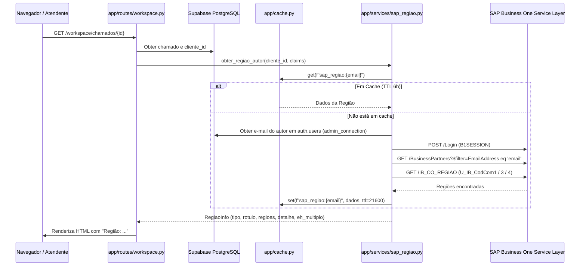

# Design Spec — Exibição de Região Comercial do Autor via SAP

**Data:** 2026-10-23  
**Status:** Aprovado  
**Autor:** Antigravity / Claude Code & Osvaldo Bello  
**Contexto:** Portal de Chamados Bondmann  

---

## 1. Objetivo e Motivação

Para chamados abertos por profissionais externos (Representantes Comerciais, Supervisores de Vendas e Gerentes de Vendas), a equipe de atendimento (especialmente TI, Comercial e Químico) frequentemente necessita saber qual é a região do profissional para dar andamento ao suporte ou configurar parâmetros em sistemas como WMW, Wtools e SAP.

Atualmente, essa informação não é apresentada no cabeçalho do chamado, obrigando a equipe de atendimento a perguntar ao solicitante na conversa do chamado ou a consultar manualmente o SAP Business One.

Esta especificação define a busca automática da região comercial diretamente no SAP Business One (tabelas `OCRD / BusinessPartners` e `IB_CO_REGIAO`), associando o e-mail do autor do chamado ao seu cadastro de Parceiro de Negócios (PN Fornecedor) e exibindo a região logo abaixo da linha "Contato: ..." no cabeçalho do chamado.

---

## 2. Arquitetura e Fluxo de Dados



---

## 3. Especificação Detalhada

### 3.1. Configuração do SAP (`app/config.py`)
Adicionar campos formais à classe `Settings`:
- `sap_api_url: str = "https://10.151.4.40:50000/b1s/v1"`
- `sap_company_db: str = ""`
- `sap_username: str = ""`
- `sap_password: str = ""`
- `sap_proxy_url: str = ""`

As variáveis já estão presentes no `.env` do projeto (`SAP_API_URL`, `SAP_COMPANY_DB`, `SAP_USERNAME`, `SAP_PASSWORD`).

### 3.2. Serviço de Consulta SAP (`app/services/sap_regiao.py`)
Novo serviço com as seguintes responsabilidades:
1. **Estrutura de Dados (`RegiaoInfo`)**:
   ```python
   @dataclass(frozen=True)
   class RegiaoInfo:
       tipo: str             # "representante" | "supervisor" | "gerente"
       rotulo: str           # ex: "057-VACARIA" ou "6 regiões vinculadas"
       regioes: list[str]    # lista de códigos/nomes de regiões
       detalhe: str          # string para tooltip (ex: "033-POA, 009-BENTO...")
       eh_multiplo: bool     # True se len(regioes) > 1
   ```
2. **Método `obter_regiao_por_email(email: str) -> RegiaoInfo | None`**:
   - Verifica cache em memória: `app.cache.get(f"sap_regiao:{email}")`.
   - Se ausente no cache:
     - Realiza login no SAP Service Layer (`POST /Login`) com timeout de 3 segundos e reaproveitamento de sessão / token `B1SESSION`.
     - Consulta `BusinessPartners` filtrando por `EmailAddress eq '{email}'` (filtrando preferencialmente `CardType eq 'cSupplier'`, com fallback para qualquer tipo se não houver fornecedor explícito).
     - Extrai os `CardCode`s válidos (ex.: `F000926`, `RH2011`, `RH2030`).
     - Consulta `IB_CO_REGIAO` com os `CardCode`s encontrados nos campos:
       - `U_IB_CodCom1`: Representante Comercial (normalmente 1 região direta).
       - `U_IB_CodCom3`: Supervisor de Vendas (equipe, 5–10 regiões).
       - `U_IB_CodCom4`: Gerente de Vendas (gerência, 15–30 regiões).
     - Monta o `RegiaoInfo`:
       - 1 região: `rotulo = regioes[0]`, `eh_multiplo = False`.
       - Múltiplas regiões: `rotulo = f"{len(regioes)} regiões vinculadas"`, `detalhe = ", ".join(regioes)`, `eh_multiplo = True`.
     - Grava no cache: `app.cache.set(f"sap_regiao:{email}", info, ttl=21600)` (6 horas).
     - Se não encontrar nada ou o usuário for interno, retorna `None` e cacheia `None` por 1 hora para evitar reconsultas desnecessárias.

3. **Método Auxiliar `obter_regiao_do_autor(cliente_id: str) -> RegiaoInfo | None`**:
   - Resolve o e-mail a partir de `cliente_id` consultando `auth.users` via `admin_connection()`.
   - Cacheia o e-mail em memória (`f"user_email:{cliente_id}"`, TTL 24 horas).
   - Invoca `obter_regiao_por_email(email)`.

### 3.3. Resiliência e Falha Silenciosa
- Qualquer falha de rede, timeout (3 segundos), erro de login ou resposta não-200 do SAP é capturada via `try...except Exception`.
- Registra `logger.warning(...)` e retorna `None`.
- **A tela de atendimento nunca quebra nem fica travada se o SAP estiver indisponível.**

### 3.4. Interface de Usuário

#### `app/templates/workspace/atendimento.html`
Logo abaixo do contato do autor:
```html
<div class="text-right text-xs text-muted">
  <div>Autor: {{ chamado.cliente_nome or "—" }}</div>
  
  <div>Contato: {{ chamado.telefone_contato }}</div>
  
  
  <div class="flex items-center justify-end gap-1">
    <span>Região:</span>
    
    <span class="font-medium text-navy cursor-help underline decoration-dotted" 
          title="{{ regiao_autor.detalhe }}">
      {{ regiao_autor.rotulo }} ℹ️
    </span>
    
    <span class="font-medium text-navy">{{ regiao_autor.rotulo }}</span>
    
  </div>
  
  <div>Aberto {{ fmt_dt(chamado.created_at) }}</div>
  ...
```

#### `app/templates/portal/chamado_detalhe.html`
Para consistência com o portal do solicitante:
```html
<div class="text-right text-xs text-muted shrink-0">
  <div>Aberto em {{ fmt_dt(chamado.created_at) }}</div>
  <div>Prazo de resolução: {{ fmt_dt(chamado.limite_resolucao) }}</div>
  
  <div>Contato: {{ chamado.telefone_contato }}</div>
  
  
  <div>Região: <span class="font-medium text-navy" title="{{ regiao_autor.detalhe }}">{{ regiao_autor.rotulo }}</span></div>
  
</div>
```

---

## 4. Plano de Testes e Validação

1. **Testes Unitários (`tests/test_sap_regiao.py`)**:
   - `test_regiao_representante_unica`: Simula retorno de PN Fornecedor e 1 região em `U_IB_CodCom1`. Verifica rótulo e `eh_multiplo=False`.
   - `test_regiao_supervisor_multipla`: Simula retorno de 6 regiões em `U_IB_CodCom3`. Verifica rótulo "6 regiões vinculadas", detalhe com a lista e `eh_multiplo=True`.
   - `test_regiao_cache`: Verifica que uma segunda chamada não atinge o SAP e recupera do `app.cache`.
   - `test_regiao_sap_offline`: Simula erro de conexão/timeout HTTP e garante retorno gracioso de `None`.
2. **Teste de Integração Real**:
   - Validar abertura de chamado com autor Representante (`douglas.melo@bondmann.com.br`) retornando `057-VACARIA`.
   - Validar que a tela de atendimento carrega com a região exibida corretamente.
