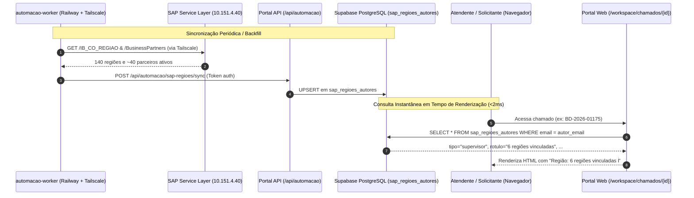

# Design Spec — Sincronização e Cache em Banco das Regiões Comerciais SAP

**Data:** 2026-10-26  
**Status:** Aprovado  
**Autor:** Antigravity / Claude Code & Osvaldo Bello  
**Contexto:** Portal de Chamados Bondmann  
**Documento Relacionado:** `docs/superpowers/specs/2026-10-23-regiao-profissional-sap-design.md`

---

## 1. Motivação e Diagnóstico

Na spec anterior (`2026-10-23-regiao-profissional-sap-design.md`), a exibição da região comercial de representantes, supervisores e gerentes foi entregue via consulta HTTP direta sob demanda à Service Layer do SAP Business One (`https://10.151.4.40:50000/b1s/v1`).

Em produção (Railway), o serviço web do Portal é executado em nuvem pública sem túnel Tailscale e sem rota direta para o IP privado `10.151.4.40`. Por consequência, a tentativa de conexão na abertura de chamados sofre timeout (3 segundos) e, pelo mecanismo de tolerância *fail-silent*, a região deixa de ser exibida (como constatado no chamado `BD-2026-01175` do supervisor Helmano Silva).

Para resolver definitivamente o problema sem onerar o container web do Portal com dependências pesadas de VPN (Tailscale) ou chaves efêmeras a rotacionar, esta especificação define a persistência de um espelho sincronizado de regiões comerciais em tabela dedicada no banco de dados Supabase (`sap_regioes_autores`).

---

## 2. Arquitetura da Solução



---

## 3. Especificação Detalhada

### 3.1. Migration no Supabase (`0098_sap_regioes_autores.sql`)

Criação da tabela de espelho e políticas de segurança (RLS):

```sql
CREATE TABLE IF NOT EXISTS public.sap_regioes_autores (
    email TEXT PRIMARY KEY,
    card_code TEXT NOT NULL,
    card_name TEXT,
    tipo TEXT NOT NULL CHECK (tipo IN ('representante', 'supervisor', 'gerente')),
    rotulo TEXT NOT NULL,
    regioes TEXT[] NOT NULL DEFAULT '{}',
    detalhe TEXT NOT NULL DEFAULT '',
    eh_multiplo BOOLEAN NOT NULL DEFAULT false,
    atualizado_em TIMESTAMPTZ NOT NULL DEFAULT now()
);

CREATE INDEX IF NOT EXISTS idx_sap_regioes_autores_card_code
    ON public.sap_regioes_autores(card_code);

ALTER TABLE public.sap_regioes_autores ENABLE ROW LEVEL SECURITY;

-- Leitura: qualquer usuário autenticado (atendentes no workspace e clientes no portal)
CREATE POLICY "sap_regioes_autores_select"
    ON public.sap_regioes_autores
    FOR SELECT
    TO authenticated
    USING (true);

-- Escrita: apenas ADMIN ou serviço interno
CREATE POLICY "sap_regioes_autores_admin_write"
    ON public.sap_regioes_autores
    FOR ALL
    TO authenticated
    USING (public.auth_role() = 'ADMIN')
    WITH CHECK (public.auth_role() = 'ADMIN');

COMMENT ON TABLE public.sap_regioes_autores IS
    'Espelho sincronizado de regiões comerciais (IB_CO_REGIAO / OCRD) do SAP Business One para exibição imediata no Portal.';
```

### 3.2. Leitura no Serviço (`app/services/sap_regiao.py`)

O método `obter_regiao_por_email(email: str)` passa a operar em camadas com prioridade ao banco:

1. **Memória de Processo:** Checa `app.cache.get(f"sap_regiao:{email}")`.
2. **Banco de Dados (Supabase):** Executa query via `admin_connection()`:
   ```sql
   SELECT tipo, rotulo, regioes, detalhe, eh_multiplo
   FROM public.sap_regioes_autores
   WHERE email = $1;
   ```
   Se encontrado, constrói `RegiaoInfo` e popula o cache por 6 horas.
3. **Fallback SAP Direto:** Se ausente no banco (ex.: novo parceiro recém-criado antes da sincronização diária) e houver credenciais/rede SAP acessíveis no processo, consulta a Service Layer diretamente via `consultar_regiao_sap(email)`.
4. **Resiliência Fail-Silent:** Se não encontrado em nenhuma camada, cacheia `__VAZIO__` por 1 hora, assegurando resposta imediata para usuários internos e clientes convencionais sem chamadas redundantes.

### 3.3. Endpoint de Sincronização (`app/routes/automacao_api.py`)

Novo endpoint REST para ingestão do espelho enviado pelo worker ou scripts autorizados:
- **Rota:** `POST /api/automacao/sap-regioes/sync`
- **Autenticação:** Header `X-Automacao-Token` (validação em tempo constante contra `AUTOMACAO_WORKER_TOKEN`).
- **Payload:**
  ```json
  [
    {
      "email": "helmano.silva@bondmann.com.br",
      "card_code": "RH2021",
      "card_name": "HELMANO SILVA",
      "tipo": "supervisor",
      "rotulo": "6 regiões vinculadas",
      "regioes": ["136-VALE DO ACO", "069-DIVINOPOLIS", "065-CONTAGEM", "130-SETE LAGOAS", "066-BELO HORIZONTE", "166-CONSELHEIRO LAFAIETE"],
      "detalhe": "136-VALE DO ACO, 069-DIVINOPOLIS, 065-CONTAGEM, 130-SETE LAGOAS, 066-BELO HORIZONTE, 166-CONSELHEIRO LAFAIETE",
      "eh_multiplo": true
    }
  ]
  ```
- **Ação:** Executa UPSERT em lote na tabela `sap_regioes_autores` e invalida caches correspondentes.

### 3.4. Script de Backfill Imediato (`scripts/backfill_sap_regioes.py`)

Script Python executável localmente para conectar simultaneamente à Service Layer do SAP e ao PostgreSQL do Supabase via DSN de produção:
1. Faz login no SAP Service Layer.
2. Recupera todos os registros de `IB_CO_REGIAO`.
3. Coleta os `CardCode`s de representantes (`U_IB_CodCom1`), supervisores (`U_IB_CodCom3`) e gerentes (`U_IB_CodCom4`).
4. Consulta `BusinessPartners` filtrando pelos `CardCode`s e extrai `EmailAddress` e `CardName`.
5. Monta a lista completa de registros e executa UPSERT em `public.sap_regioes_autores`.

---

## 4. Plano de Validação e Testes

1. **Testes Unitários de Regressão e Integração:**
   - `tests/test_sap_regiao.py`: Validação de busca no banco com mock do `admin_connection()`.
   - `tests/test_automacao_api.py`: Validação da rota `POST /api/automacao/sap-regioes/sync` (200 com token correto, 401 com token incorreto, validação de payload).
   - `tests/test_templates_regiao.py`: Garantia de renderização do Jinja nos templates de atendimento e portal.
2. **Validação com Chamado Real (`BD-2026-01175`):**
   - Rodar backfill e verificar se `helmano.silva@bondmann.com.br` está gravado com as 6 regiões vinculadas.
   - Testar chamada `await obter_regiao_do_autor(cliente_id_helmano)` e confirmar retorno de `RegiaoInfo` em <10ms.
3. **Suíte e Linting:**
   - `ruff check .` e `pytest` 100% verdes.
